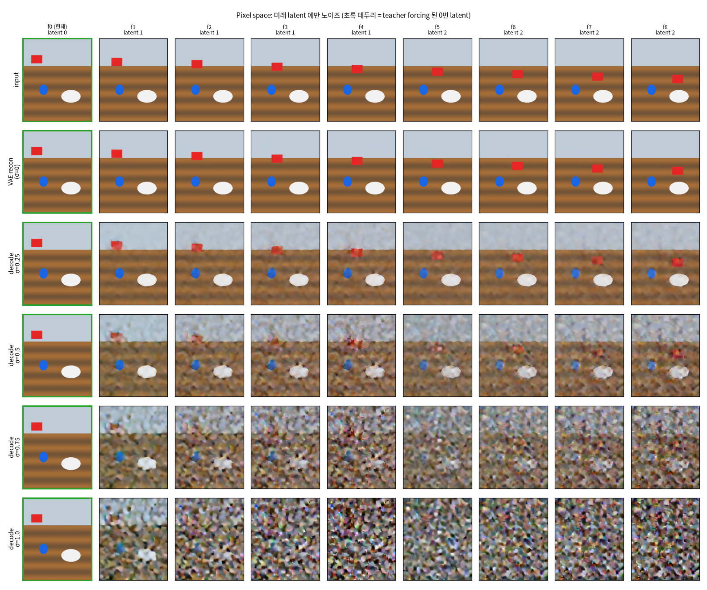
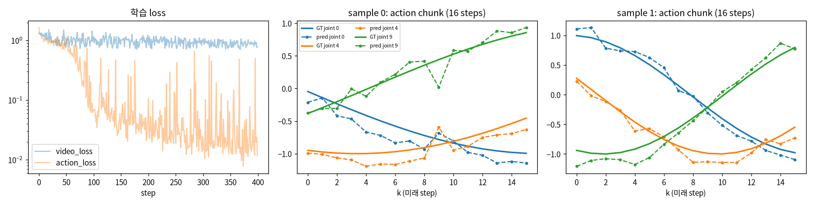
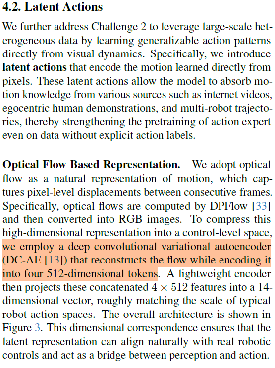

# Motus: A Unified Latent Action World Model — 직접 구현하기

[Motus](https://github.com/thu-ml/Motus) 논문의 방법론을 이해하기 위해 모델의 각 구성요소를 직접 구현해 보는 저장소입니다.


위 그림은 Motus의 main figure입니다.

Motus는 **Video Generation Expert(WAN2.2-5B)**, **Action Expert**, **Understanding Expert** 세 expert를 **Mixture-of-Transformers(MoT)** 구조의 joint attention으로 묶습니다. 이해 정보는 **pretrained VLM(Qwen3-VL-2B, frozen)**에서 얻습니다.

이 저장소는 두 단계로 구현합니다.
1. **토큰화**: MoT에 들어가기 전, 각 모달리티를 토큰으로 바꾸는 단계
2. **MoT 본체**: 세 tower가 레이어마다 joint attention으로 맞물려 video와 action의 velocity를 예측하는 단계

검증 단계에서는 **레이어 5개(원본 30개), pretrained backbone 없이 랜덤 초기화, dummy data**로 shape과 학습 가능성만 확인합니다.

---

## 구현 현황

**토큰화 / 조건**

| 파일 | 구성요소 | 입력 | 출력 | 학습 여부 |
| --- | --- | --- | --- | --- |
| [`VLM.py`](./VLM.py) | Pretrained VLM (Qwen3-VL-2B) | 현재 관측 이미지 + 지시문 | `[B, L_vlm, 2048]` | frozen |
| [`Video_encoder.py`](./Video_encoder.py) | Video Encoder (Wan2.2 VAE + patch embedding) | 현재 프레임 `[B,3,H,W]` + 미래 GT 프레임 `[B,F,3,H,W]` | `[B, 360, 3072]` | VAE frozen, patch embedding 학습 |
| [`Action_encoder.py`](./Action_encoder.py) | Action Encoder (state/action MLP + registers) | state `[B,14]` + actions `[B,16,14]` | `[B, 21, 1024]` | from scratch |
| [`Text_encoder.py`](./Text_encoder.py) | T5 text context (video cross-attention용 조건) | umT5 출력 `[L, 4096]` | `[B, 512, 3072]` | text_embedding 학습 |

**MoT 본체**

| 파일 | 구성요소 | 입력 | 출력 |
| --- | --- | --- | --- |
| [`joint_attention.py`](./joint_attention.py) | trimodal joint self-attention (3D RoPE는 video에만) | 세 tower의 q, k, v `[B, L, 24, 128]` | `o_v`, `o_a`, `o_u` |
| [`towers/video_tower.py`](./towers/video_tower.py) | Video Generation Tower (WAN 블록) | video tokens + T5 context | video velocity `[B,48,3,24,20]` |
| [`towers/action_tower.py`](./towers/action_tower.py) | Action Expert Tower | action tokens | action velocity `[B,16,14]` |
| [`towers/und_tower.py`](./towers/und_tower.py) | Understanding Expert Tower | VLM hidden `[B, L_u, 2048]` | (없음, K/V만 제공) |
| [`MOTUS.py`](./MOTUS.py) | 조립: 레이어 루프, loss, 추론 | 위 전부 | loss / 예측 action |

> shape은 RoboTwin 설정 기준입니다 (`H=384`, `W=320`, `F=8`, `action_chunk=16`).

각 스크립트는 원본 코드와 같은 방식으로 동작하며, dummy input으로 바로 실행해 입출력 shape을 확인할 수 있습니다.

```bash
python VLM.py
python Video_encoder.py
python Action_encoder.py
python Text_encoder.py
python joint_attention.py
python -m towers.video_tower          # action_tower, und_tower 도 같은 방식
python MOTUS.py --steps 400 --lr 2e-4 # 전체 조립 + dummy overfit 검증
python visualize_video_encoder.py     # VAE + 노이즈 시각화 (--image <경로> 로 원하는 이미지 사용 가능)
```

---

## 1. Pretrained VLM — `VLM.py`

- `transformers`의 `Qwen3VLForConditionalGeneration`으로 불러오고, `AutoProcessor`와 `qwen_vl_utils.process_vision_info`로 전처리합니다.
- 입력 시퀀스: `[user template | image patch tokens | instruction tokens | "<|im_start|>assistant\n"]`
- **generation은 하지 않습니다.** language model을 한 번 forward해서 얻은 **마지막 레이어 hidden state**를 Understanding Expert의 입력으로 씁니다.

## 2. Video Encoder — `Video_encoder.py`

```
[현재 1장 | 미래 GT F장]  [B,3,1+F,H,W]
   │  Wan2.2 VAE (frozen): 공간 16배, 시간 4배 압축
   ▼
latent  [B,48,1+F/4,H/16,W/16] = [B,48,3,24,20]
   │  미래 latent에만 flow-matching 노이즈 (0번 latent는 teacher forcing)
   ▼
   │  patch embedding: Conv3d(48→3072, kernel=(1,2,2))
   ▼
video tokens  [B,360,3072]
```

- 토큰 하나는 **시공간 패치**입니다. 공간적으로는 픽셀 32×32 영역을, 시간적으로는 프레임 4장을 담습니다. 0번 latent만 예외로 첫 프레임 1장만 담습니다.
- 0번 latent는 현재 관측이라 항상 깨끗한 값으로 쓰이고 loss에서 제외됩니다. 1번 이후 latent는 노이즈가 섞인 미래 장면이고, 모델은 이 부분의 velocity를 예측합니다.
- **추론 때는 미래 프레임이 없으므로** 미래 latent가 순수 노이즈에서 시작합니다.

### 시각화



노이즈를 섞은 latent를 VAE decoder로 다시 픽셀로 되돌린 모습입니다. 초록 테두리가 teacher forcing된 0번 latent입니다. σ가 커질수록 미래 장면의 구조가 사라집니다.


48채널 latent를 PCA로 3채널로 줄여 latent 자체를 본 모습입니다. latent 1과 2에서 빨간 물체가 **번진 자국**처럼 보이는 이유는, latent 하나가 프레임 4장의 움직임을 요약하기 때문입니다.

## 3. Action Encoder — `Action_encoder.py`

```
state  [B,1,14]   ── state_encoder  (MLP 14→1024) ─┐
actions[B,16,14]  ── + noise ── action_encoder (MLP 14→1024) ─┤ concat + 1D sin-cos 위치 임베딩
registers [B,4,1024] (학습 가능한 slot) ─────────────────┘
                                   ▼
                     action tokens [B, 1+16+4, 1024]
```

- **state 토큰**: 현재 관절 상태(proprioception)이며 노이즈가 없는 조건입니다.
- **action 토큰**: k스텝 뒤에 로봇이 있어야 할 관절 상태이고, chunk 전체는 미래 관절 궤적입니다. 학습 중에는 노이즈가 섞인 상태로 들어갑니다.
- **register 토큰**: 데이터와 무관한 학습 가능한 slot입니다. attention에는 참여하지만 최종 출력에서는 버려집니다.
- state와 action은 같은 관절값이지만 **깨끗한 조건과 노이즈가 섞인 생성 대상**으로 입력 분포가 달라서 MLP를 따로 둡니다.

## 4. Text Encoder — `Text_encoder.py`

```
지시문 → umT5-XXL (frozen, 오프라인) → [L, 4096] → 512 패딩 → text_embedding (4096→3072) → T5 context [B,512,3072]
```

- 논문 본문에는 나오지 않지만, WAN은 원래 **T5 텍스트를 cross-attention으로 받도록 사전학습된** text(+image)-to-video 모델입니다. Motus도 이 경로를 그대로 살립니다.
- T5 context는 **video 토큰의 cross-attention에서 K/V로만** 쓰입니다. action과 und 토큰은 T5를 직접 보지 않습니다.
- 그래서 지시문은 두 경로로 들어갑니다. 하나는 VLM을 거쳐 und 토큰으로 joint attention에 들어가고(video와 action 모두에 전달), 다른 하나는 T5를 거쳐 cross-attention으로 들어갑니다(video에만 전달).
- 원본은 `text_embedding`을 WAN 모델 안에 두지만, 여기서는 조건 준비 단계로 보고 `Text_encoder.py`에 분리했습니다. 연산은 같습니다.

## 5. MoT 본체 — `towers/`, `joint_attention.py`, `MOTUS.py`

세 tower는 30개 레이어를 각자 따로 돌지 않습니다. **레이어마다 Q/K/V를 모아 attention을 한 번** 수행해야 하므로, tower는 레이어 단위 부품(`qkv` / `attn_out` / `ffn` / `head`)만 내주고 **레이어 루프는 `MOTUS.py`가 돕니다.**

```
for i in range(num_layers):
    ① modulation : video / action AdaLN 파라미터 (timestep 조건)
    ② qkv        : 세 tower가 각자 WAN head space(24 heads × 128)로 사영
    ③ joint attention : [video | action | und] concat → 3D RoPE(video만) → attention 한 번 → split
    ④ attn_out   : 출력 사영 + residual (video/action은 AdaLN gate)
    ⑤ cross-attn : video 토큰 × T5 context  (video만)
    ⑥ ffn        : 각 tower의 FFN
head : video → unpatchify → velocity [B,48,3,24,20]
       action → decoder → [:, 1:17] → velocity [B,16,14]   (state / register 토큰 제거)
```

| tower | 차원 | AdaLN (timestep) | cross-attn | head | 초기화 |
| --- | --- | --- | --- | --- | --- |
| Video | 3072 (FFN 14336) | ✅ | ✅ T5 | ✅ | pretrained WAN (검증에서는 랜덤) |
| Action | 1024 (FFN 4096) | ✅ | ❌ | ✅ decoder | from scratch |
| Und | 512 (FFN 2048) | ❌ | ❌ | ❌ | from scratch |

- **학습**: video와 action에 서로 독립인 timestep σ로 노이즈를 섞고, velocity(`noise − clean`)를 MSE로 맞춥니다. video loss에서는 0번 latent를 제외합니다.
- **추론**: 미래 video latent와 action을 순수 노이즈에서 시작해, t를 1에서 0으로 줄이며 Euler 적분합니다. 매 스텝 0번 latent는 현재 관측으로 다시 덮어씁니다(teacher forcing).
- 원본은 joint attention을 WAN self-attention 안에 넣어 두었지만, 여기서는 `joint_attention.py`로 분리해 세 tower를 대칭적인 형태로 만들었습니다. **파라미터 이름은 원본 checkpoint 키와 같게** 맞췄습니다.

## 6. 검증

### (1) 원본 코드와 같은 연산인가
같은 가중치와 같은 입력으로 원본 Motus 레이어 1개(`models/motus.py`)와 비교했습니다. 가중치 키는 모두 일치했고(누락 0), 출력 차이는 bf16 반올림 수준입니다.

| 출력 | 상대오차 |
| --- | --- |
| video velocity | 3.2e-3 |
| action decoder | 4.1e-4 |
| und tokens | 4.1e-4 |

### (2) dummy 데이터로 action을 예측하는가
랜덤 초기화 모델이므로 **고정된 dummy 배치(B=2)에 overfit한 뒤, 순수 노이즈에서 10 Euler step으로 action을 복원하는지** 확인했습니다.

| | sample 0 | sample 1 |
| --- | --- | --- |
| 학습 전 action MSE | 1.427 | 1.343 |
| **학습 후 action MSE** (400 steps) | **0.015** | **0.013** |
| 참고: 두 GT의 평균을 예측할 때 | 0.107 | 0.107 |
| 조건을 맞바꾼 뒤, 바뀐 조건의 GT와 비교 | 0.017 | 0.012 |



- 학습 후 오차가 평균 예측 기준선보다 약 7배 작습니다. 샘플별로 서로 다른 궤적을 생성합니다.
- 두 샘플의 조건(state, latent, 지시문, VLM 특징)을 맞바꾸면 예측도 바뀐 조건의 GT를 따라갑니다. 조건 정보가 joint attention을 거쳐 action 생성에 실제로 쓰인다는 뜻입니다.
- 11GB GPU 메모리 때문에 이 검증에서는 **video 블록만 고정**하고 나머지 2.5억 개 파라미터를 학습했습니다(최대 8.1GB). 전부 학습하려면 `--train_video_blocks` 옵션을 쓰면 되는데, 더 큰 GPU가 필요합니다.
- 이 결과는 데이터 흐름과 학습 가능성을 확인한 것입니다. 일반화 성능은 실제 데이터와 pretrained 가중치가 있어야 평가할 수 있습니다.

---

## 참고: 3단계 학습

| 단계 | 학습 대상 | Video 경로 | Action 경로 |
| --- | --- | --- | --- |
| Stage 1 | 비디오 생성 모델만 | ✅ | – |
| Stage 2 | 세 expert 모두 (VLM frozen) | ✅ | **latent action** (14차원, state 없음) |
| Stage 3 | 세 expert 모두 | ✅ | **실제 로봇 action** + state |

- Video Encoder는 Stage 1에서만 쓰이지 않고 **모든 단계**에서 쓰입니다.
- Stage 2의 latent action은 학습 중에 계산하지 않습니다. 별도로 학습한 Latent Action VAE로 **미리 계산해 둔 label**을 읽어 씁니다(아래 참고).
- 이 저장소의 `Action_encoder.py`는 Stage 3(state + register) 방식입니다.

---

## 참고: Latent Action (Stage 2 pretraining)



논문은 **optical flow based representation**을 사용합니다. 실제 로봇 action label이 없는 인터넷 영상이나 사람 시연 영상에서도, 로봇이 활용할 수 있는 action representation을 학습하겠다는 목적입니다.

- **Optical flow**는 연속된 두 프레임 사이에서 각 픽셀이 얼마나, 어느 방향으로 이동했는지를 나타내는 표현입니다. 실제 로봇 관절값을 몰라도 영상에서 움직임 패턴을 뽑아낼 수 있습니다.
- 논문은 DPFlow로 optical flow를 계산해 RGB 이미지로 바꾸고, DC-AE로 512차원 토큰 4개로 압축합니다. 이것을 다시 가벼운 encoder로 **14차원 latent action**으로 만들어 로봇 action space와 크기를 맞춥니다.


위 그림은 **Latent Action VAE**입니다. Video Encoder의 Wan2.2 VAE와는 다른 모델입니다.

| | Wan2.2 VAE (Video Encoder) | Latent Action VAE (Fig. 3) |
| --- | --- | --- |
| 입력 | RGB 프레임 | optical flow (RGB로 변환한 것) |
| 출력 | video latent `[48, T', H', W']` | latent action `z_t` (14차원) |
| 쓰이는 곳 | 비디오 생성 경로 (모든 단계) | Stage 2 pretraining에서 **Action Expert의 action label 대신** 사용 |

> 원본 저장소에는 Latent Action VAE 학습 코드가 없습니다. 미리 계산된 `latent_action_dim14/` label만 데이터로 사용합니다 (`DATA_FORMAT.md` 참고).

---

## 디렉터리 구조

```
00_MY_implementation/
├── VLM.py                       # Pretrained VLM (Qwen3-VL-2B)
├── Video_encoder.py             # Wan2.2 VAE + patch embedding
├── Action_encoder.py            # state/action encoder + registers
├── Text_encoder.py              # T5 context (패딩 + text_embedding)
├── joint_attention.py           # 3D RoPE + trimodal joint attention
├── towers/
│   ├── layers.py                # 공용 부품 (norm, sinusoidal, MLP, AdaLN 분할)
│   ├── video_tower.py           # Video Generation Tower (WAN 블록)
│   ├── action_tower.py          # Action Expert Tower
│   └── und_tower.py             # Understanding Expert Tower
├── MOTUS.py                     # 조립: 레이어 루프, training_step, inference_step, 검증
├── visualize_video_encoder.py   # VAE + 노이즈 시각화
├── modules/                     # Wan2.2 VAE 코드 (원본에서 복사, Apache-2.0)
│   ├── vae2_2.py
│   └── device_utils.py
├── images/                      # 논문 그림
└── outputs/                     # 시각화 결과
```

## 사전학습 가중치

처음 실행하면 Hugging Face Hub에서 자동으로 받습니다. `MOTUS.py` 검증은 pretrained 가중치 없이 실행됩니다. VLM과 VAE 출력 대신 dummy 텐서를 입력으로 씁니다.

| 모델 | 저장소 | 사용하는 파일 |
| --- | --- | --- |
| Qwen3-VL-2B | [`Qwen/Qwen3-VL-2B-Instruct`](https://huggingface.co/Qwen/Qwen3-VL-2B-Instruct) | 전체 (~4GB) |
| Wan2.2-TI2V-5B | [`Wan-AI/Wan2.2-TI2V-5B`](https://huggingface.co/Wan-AI/Wan2.2-TI2V-5B) | `Wan2.2_VAE.pth`, `config.json`, safetensors index와 첫 번째 shard |

## 환경

- Python (conda base), PyTorch 2.7.1 + CUDA 12.8
- `transformers==5.0.0rc0`, `qwen-vl-utils`, `safetensors`, `huggingface_hub`, `einops`, `matplotlib`

## Reference

```bibtex
@misc{bi2025motusunifiedlatentaction,
      title={Motus: A Unified Latent Action World Model},
      author={Hongzhe Bi and Hengkai Tan and Shenghao Xie and Zeyuan Wang and Shuhe Huang and Haitian Liu and Ruowen Zhao and Yao Feng and Chendong Xiang and Yinze Rong and Hongyan Zhao and Hanyu Liu and Zhizhong Su and Lei Ma and Hang Su and Jun Zhu},
      year={2025},
      eprint={2512.13030},
      archivePrefix={arXiv},
      primaryClass={cs.CV},
      url={https://arxiv.org/abs/2512.13030},
}
```

- 논문: <https://arxiv.org/abs/2512.13030>
- 원본 코드: <https://github.com/thu-ml/Motus>
