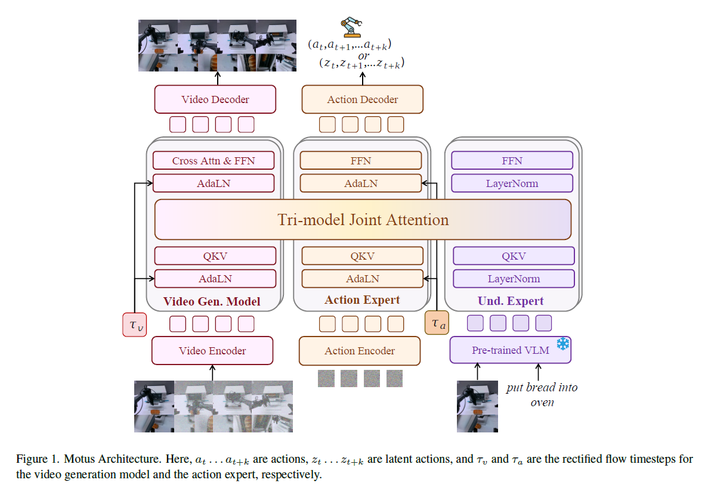
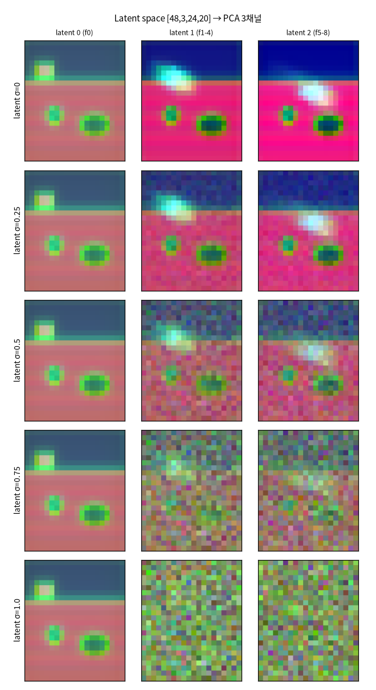
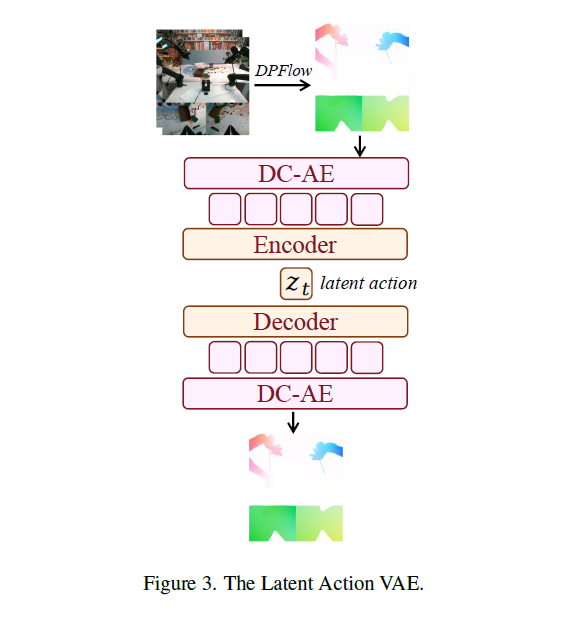

# Motus: A Unified Latent Action World Model — 직접 구현하기

[Motus](https://github.com/thu-ml/Motus) 논문의 방법론을 이해하기 위해 모델의 각 구성요소를 직접 구현해 보는 저장소입니다.



위 그림은 Motus의 main figure입니다.

Motus는 **Video Generation Expert(WAN2.2-5B)**, **Action Expert**, **Understanding Expert** 세 expert를 **Mixture-of-Transformers(MoT)** 구조의 joint attention으로 묶습니다. 이해 정보는 **pretrained VLM(Qwen3-VL-2B, frozen)**에서 얻습니다.

이 저장소는 먼저 **MoT에 들어가기 전, 각 모달리티를 토큰으로 바꾸는 단계**를 구현합니다.

---

## 구현 현황

| 파일 | 구성요소 | 입력 | 출력 | 학습 여부 |
| --- | --- | --- | --- | --- |
| [`VLM.py`](./VLM.py) | Pretrained VLM (Qwen3-VL-2B) | 현재 관측 이미지 + 지시문 | `[B, L_vlm, 2048]` | frozen |
| [`Video_encoder.py`](./Video_encoder.py) | Video Encoder (Wan2.2 VAE + patch embedding) | 현재 프레임 `[B,3,H,W]` + 미래 GT 프레임 `[B,F,3,H,W]` | `[B, 360, 3072]` | VAE frozen, patch embedding 학습 |
| [`Action_encoder.py`](./Action_encoder.py) | Action Encoder (state/action MLP + registers) | state `[B,14]` + actions `[B,16,14]` | `[B, 21, 1024]` | from scratch |
| `MOTUS.py` | MoT 본체 (joint attention, AdaLN, FFN) | – | – | 🚧 예정 |

> shape은 RoboTwin 설정 기준입니다 (`H=384`, `W=320`, `F=8`, `action_chunk=16`).

각 스크립트는 원본 코드와 같은 방식으로 동작하며, dummy input으로 바로 실행해 입출력 shape을 확인할 수 있습니다.

```bash
python VLM.py
python Video_encoder.py
python Action_encoder.py
python visualize_video_encoder.py            # VAE + 노이즈 시각화 (--image <경로> 로 원하는 이미지 사용 가능)
```

---

## 1. Pretrained VLM — `VLM.py`

- `transformers`의 `Qwen3VLForConditionalGeneration`으로 불러오고, `AutoProcessor`와 `qwen_vl_utils.process_vision_info`로 전처리합니다.
- 입력 시퀀스: `[user template | image patch tokens | instruction tokens | "<|im_start|>assistant\n"]`
- **generation은 하지 않습니다.** language model을 한 번 forward해서 얻은 **마지막 레이어 hidden state**를 Understanding Expert의 입력으로 씁니다.

## 2. Video Encoder — `Video_encoder.py`

```
[현재 1장 | 미래 GT F장]  [B,3,1+F,H,W]
   │  Wan2.2 VAE (frozen): 공간 16배, 시간 4배 압축
   ▼
latent  [B,48,1+F/4,H/16,W/16] = [B,48,3,24,20]
   │  미래 latent에만 flow-matching 노이즈 (0번 latent는 teacher forcing)
   ▼
   │  patch embedding: Conv3d(48→3072, kernel=(1,2,2))
   ▼
video tokens  [B,360,3072]
```

- 토큰 하나는 **시공간 패치**입니다. 공간적으로는 픽셀 32×32 영역을, 시간적으로는 프레임 4장을 담습니다. 0번 latent만 예외로 첫 프레임 1장만 담습니다.
- 0번 latent는 현재 관측이라 항상 깨끗한 값으로 쓰이고 loss에서 제외됩니다. 1번 이후 latent는 노이즈가 섞인 미래 장면이고, 모델은 이 부분의 velocity를 예측합니다.
- **추론 때는 미래 프레임이 없으므로** 미래 latent가 순수 노이즈에서 시작합니다.

### 시각화


노이즈를 섞은 latent를 VAE decoder로 다시 픽셀로 되돌린 모습입니다. 초록 테두리가 teacher forcing된 0번 latent입니다. σ가 커질수록 미래 장면의 구조가 사라집니다.



48채널 latent를 PCA로 3채널로 줄여 latent 자체를 본 모습입니다. latent 1과 2에서 빨간 물체가 **번진 자국**처럼 보이는 이유는, latent 하나가 프레임 4장의 움직임을 요약하기 때문입니다.

## 3. Action Encoder — `Action_encoder.py`

```
state  [B,1,14]   ── state_encoder  (MLP 14→1024) ─┐
actions[B,16,14]  ── + noise ── action_encoder (MLP 14→1024) ─┤ concat + 1D sin-cos 위치 임베딩
registers [B,4,1024] (학습 가능한 slot) ─────────────────┘
                                   ▼
                     action tokens [B, 1+16+4, 1024]
```

- **state 토큰**: 현재 관절 상태(proprioception)이며 노이즈가 없는 조건입니다.
- **action 토큰**: k스텝 뒤에 로봇이 있어야 할 관절 상태이고, chunk 전체는 미래 관절 궤적입니다. 학습 중에는 노이즈가 섞인 상태로 들어갑니다.
- **register 토큰**: 데이터와 무관한 학습 가능한 slot입니다. attention에는 참여하지만 최종 출력에서는 버려집니다.

---

## 참고: Latent Action (Stage 2 pretraining)


논문은 **optical flow based representation**을 사용합니다. 실제 로봇 action label이 없는 인터넷 영상이나 사람 시연 영상에서도, 로봇이 활용할 수 있는 action representation을 학습하겠다는 목적입니다.

- **Optical flow**는 연속된 두 프레임 사이에서 각 픽셀이 얼마나, 어느 방향으로 이동했는지를 나타내는 표현입니다. 실제 로봇 관절값을 몰라도 영상에서 움직임 패턴을 뽑아낼 수 있습니다.
- 논문은 DPFlow로 optical flow를 계산해 RGB 이미지로 바꾸고, DC-AE로 512차원 토큰 4개로 압축합니다. 이것을 다시 가벼운 encoder로 **14차원 latent action**으로 만들어 로봇 action space와 크기를 맞춥니다.



위 그림은 **Latent Action VAE**입니다. Video Encoder의 Wan2.2 VAE와는 다른 모델입니다.

| | Wan2.2 VAE (Video Encoder) | Latent Action VAE (Fig. 3) |
| --- | --- | --- |
| 입력 | RGB 프레임 | optical flow (RGB로 변환한 것) |
| 출력 | video latent `[48, T', H', W']` | latent action `z_t` (14차원) |
| 쓰이는 곳 | 비디오 생성 경로 (모든 단계) | Stage 2 pretraining에서 **Action Expert의 action label 대신** 사용 |

> 원본 저장소에는 Latent Action VAE 학습 코드가 없습니다. 미리 계산된 `latent_action_dim14/` label만 데이터로 사용합니다 (`DATA_FORMAT.md` 참고).

---

## 디렉터리 구조

```
00_MY_implementation/
├── VLM.py                       # Pretrained VLM (Qwen3-VL-2B)
├── Video_encoder.py             # Wan2.2 VAE + patch embedding
├── Action_encoder.py            # state/action encoder + registers
├── MOTUS.py                     # (예정) MoT 본체
├── visualize_video_encoder.py   # VAE + 노이즈 시각화
├── modules/                     # Wan2.2 VAE 코드 (원본에서 복사, Apache-2.0)
│   ├── vae2_2.py
│   └── device_utils.py
├── images/                      # 논문 그림
└── outputs/                     # 시각화 결과
```

## 사전학습 가중치

처음 실행하면 Hugging Face Hub에서 자동으로 받습니다.

| 모델 | 저장소 | 사용하는 파일 |
| --- | --- | --- |
| Qwen3-VL-2B | [`Qwen/Qwen3-VL-2B-Instruct`](https://huggingface.co/Qwen/Qwen3-VL-2B-Instruct) | 전체 (~4GB) |
| Wan2.2-TI2V-5B | [`Wan-AI/Wan2.2-TI2V-5B`](https://huggingface.co/Wan-AI/Wan2.2-TI2V-5B) | `Wan2.2_VAE.pth`, `config.json`, safetensors index와 첫 번째 shard |

## 환경

- Python (conda base), PyTorch 2.7.1 + CUDA 12.8
- `transformers==5.0.0rc0`, `qwen-vl-utils`, `safetensors`, `huggingface_hub`, `einops`, `matplotlib`

## Reference

```bibtex
@misc{bi2025motusunifiedlatentaction,
      title={Motus: A Unified Latent Action World Model},
      author={Hongzhe Bi and Hengkai Tan and Shenghao Xie and Zeyuan Wang and Shuhe Huang and Haitian Liu and Ruowen Zhao and Yao Feng and Chendong Xiang and Yinze Rong and Hongyan Zhao and Hanyu Liu and Zhizhong Su and Lei Ma and Hang Su and Jun Zhu},
      year={2025},
      eprint={2512.13030},
      archivePrefix={arXiv},
      primaryClass={cs.CV},
      url={https://arxiv.org/abs/2512.13030},
}
```

- 논문: <https://arxiv.org/abs/2512.13030>
- 원본 코드: <https://github.com/thu-ml/Motus>
